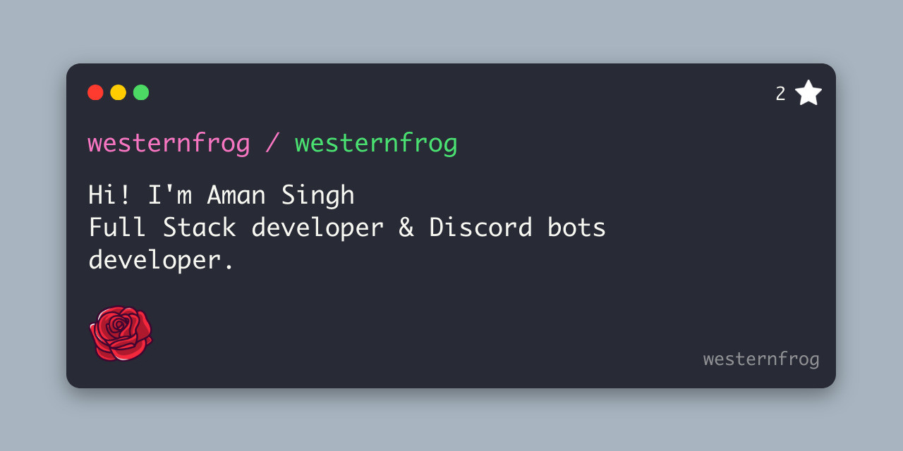

## Hi, I'm Aman Singh 👋🐸

I am a Full-Stack Developer✨. Currently, I am pursuing a bachelor's degree in Engineering in Computer Science 🧑‍💻. I have skills in Web Development and have been building websites for the past 3 years using Nextjs. These days, my main focus is to learn more about Redis 🐷. I am always ready for new experiences 🐥, to meet new people 🐸, and to learn new things 🤩.

### 🛠️ What I'm working on
- 📡 Distributed Wi-Fi test automation across Linux and Windows clients
- 📶 Wi-Fi 6 / Wi-Fi 7 performance testing (MLO, 320 MHz)
- 📊 Real-time throughput dashboards and automated test reports
- 🦀 Learning Rust for cross-platform desktop apps

### 🧑‍💻 Tech Stack

### 🤫 Stalk me here:

